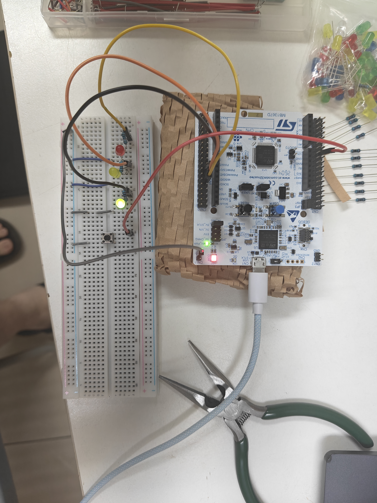
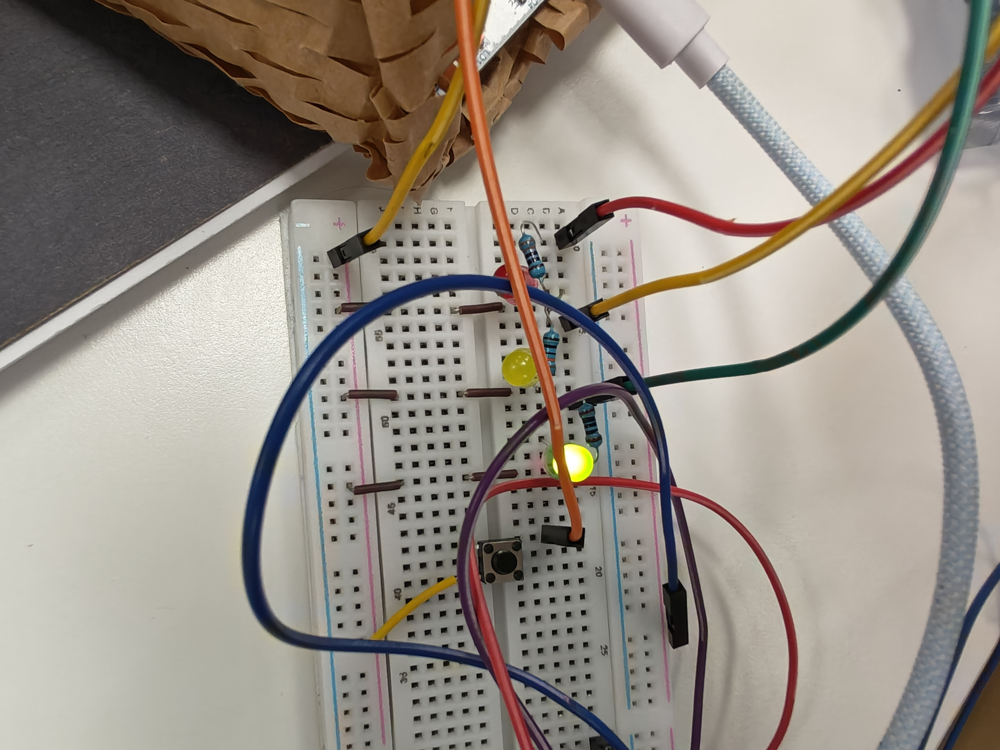
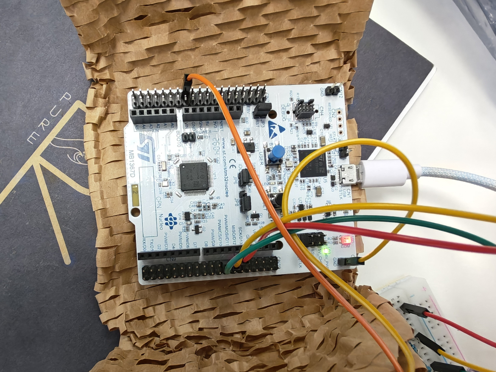

# Xie-s-repo

# 🏎️ F1賽車極限起跑反應力測試儀 (NUCLEO-G474RE 期中專題)

勝負就在 0.2 秒的決策瞬間！本專題結合 STM32 微控制器與 Python 上位機，實現微秒級反應時間量測與防偷跑違規判定。

## 1. 情境故事：誰、在哪、遇到什麼麻煩
* **使用者與場景**：F1 賽車手在起跑線上準備起跑，必須在起跑燈號熄滅瞬間釋放離合器衝刺。
* **痛點**：起跑燈號倒數時間隨機，若提早按壓會被判定為「偷跑 (False Start)」直接失格；反應過慢則落後對手。系統需要極高精度量測反應毫秒/微秒數。

## 2. 替身對照：故事裡的模組 -> 板上替身
* **起跑號誌燈** -> 麵包板外接紅、黃、綠三色 LED (GPIO 推挽輸出，搭 220Ω 限流電阻)
* **車手離合器按鈕** -> 外接獨立按鈕 / 板載 B1 按鈕 (PC13，GPIO 輸入 + EXTI 下降沿中斷)
* **計時與數據連線** -> TIM2 微秒計時器 + USART2 (PA2/PA3) 透過 ST-Link 虛擬 COM Port 傳送至 Python

## 3. 功能與驗收條件：動作、預期、實測結果
* **動作**：系統進入隨機倒數（1.5 ~ 3.0 秒），綠燈亮起瞬間啟動計時，使用者按下按鈕結算。
* **預期**：
  * 倒數期間按壓 -> 觸發 EXTI 中斷，回傳 `FALSE_START`，熄滅燈號。
  * 綠燈亮起按壓 -> 抓取 TIM2 微秒計數，回傳 `TIME:XXXX_US` 並於 Python 換算為秒（s）。
  * 超過 3 秒未按 -> 觸發超時機制，回傳 `TIMEOUT`。
* **實測結果**：Python 上位機可精確監聽並解析微秒成績與狀態，格式正常顯示。

## 4. 用到的技術：第 3 ~ 7 週勾選表 (同投影片)
* [x] **W3 GPIO**：推挽輸出控制三色 LED，輸入腳位與內部 Pull-up 設定
* [x] **W4 RCC/PLL**：配置 170 MHz 高頻時脈系統，提供高精度計時基底
* [x] **W5 EXTI/NVIC**：按鈕中斷觸發 ISR，實現防偷跑即時攔截與去彈跳
* [x] **W6 UART**：115200 Baud Rate 非阻塞字串傳輸
* [x] **W7 Timer/pySerial**：TIM2 1MHz 硬體計時器與 Python pySerial 數據解析

## 5. 腳位表：用到的每支腳位與用途
* `PA5` = 綠燈 (LD2)
* `PB0` = 黃燈
* `PB1` = 紅燈
* `PC13` = 按鈕 (B1 / 外接按鈕 EXTI15_10 中斷來源)
* `PA2 / PA3` = USART2_TX / USART2_RX (連接 ST-Link 虛擬串口，Baud Rate 115200)

## 6. 建置與執行：開發環境、燒錄步驟、終端機設定、命令
* **開發環境**：STM32CubeIDE (C/HAL) + Anaconda (Jupyter Notebook / Python 3)
* **燒錄步驟**：以 STM32CubeIDE 開啟 `Minterm_Project`，編譯後以 ST-Link 燒錄至 NUCLEO-G474RE。
* **終端機設定**：`COM4` (依裝置管理員為準), 115200 Baud Rate, 8N1。
* **執行命令**：開啟 Anaconda Prompt 輸入 `jupyter notebook`，執行 `python terminal/Untitled3(1).ipynb`。

## 7. 實作照片：每張附一行圖說


*圖 1：F1 賽車起跑測試儀系統整體實作畫面，包含 STM32 主板、麵包板周邊電路與電腦端 Python 顯示畫面。*


*圖 2：NUCLEO-G474RE 連結外接紅黃綠三色 LED（搭配限流電阻）與獨立 EXTI 按鈕之電路接線細節。*


*圖 3：NUCLEO-G474RE 開發板特寫，展示板載 ST-Link 虛擬 COM Port 與微控制器系統。*

## 8. AI 使用說明：哪段請 AI、你怎麼查核
* **ChatGPT/Gemini 協助內容**：
  * 協助撰寫與排版 Markdown `README.md` 的架構與樹狀目錄[cite: 5]。
  * 提供 Python `pySerial` 解析微秒字串並換算為秒數的代碼片段[cite: 4]。
* **查核方式**：
  * 實際於 Jupyter Notebook 測試 COM Port 接收，確認 `TIME:XXXX_US` 能正確除以 1,000,000 並轉換為秒[cite: 4]。
  * 透過 Git Bash 測試 `git push` 後在 GitHub 網頁查看渲染效果，確保圖片與結構無破圖[cite: 4, 5]。

## 9. 已知限制：哪些用替身、換真貨要改哪裡
* **限制一（按鈕觸感）**：目前使用普通微觸按鈕替代真實賽車離合器撥片，若換成真貨需調整 EXTI 去彈跳時間（Debounce Time）。
* **限制二（燈號功率）**：目前採用小功率 LED，若換成賽車場高亮度燈牆，需新增 Darlington 電晶體驅動電路或繼電器模組。

## 10. 程式結構：哪個檔做什麼、ISR 與主迴圈分工
* **ISR 與主迴圈分工**：
  * `HAL_GPIO_EXTI_Callback()`：中斷服務常式，負責捕捉按鈕按下瞬間，設定標記與時間點。
  * `main.c` 主迴圈：負責 FSM 狀態切換 (`GAME_READY` -> `GAME_COUNTDOWN` -> `GAME_GO` -> `GAME_OVER`) 與 UART 訊息發送。

* **檔案目錄與說明**：

```text
Xie-s-repo/
├── .gitignore                             # Git 版本控制忽略檔
├── README.md                              # 專案說明文件
├── Pictures/                              # 實作照片資料夾
│   ├── Fullshot.jpg                       # 系統全貌與整體擺設圖
│   ├── Line-setup.jpg                     # 硬體電路與線路接線細節
│   └── MCUhighlight.jpg                   # STM32 微控制器核心特寫
├── python terminal/                       # Python 上位機程式資料夾
│   └── Untitled3(1).ipynb                 # Jupyter Notebook 序列埠監聽與解析腳本
└── Minterm_Project/                       # STM32 韌體專案資料夾 (CubeIDE)
    └── Core/Src/main.c                    # 主程式 (FSM 狀態機與計時邏輯)